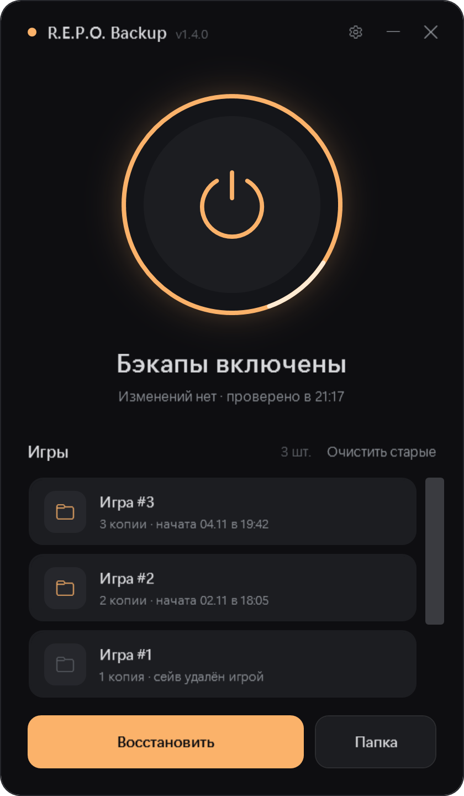

# R.E.P.O. Backup

Небольшая программа для Windows, которая автоматически делает резервные копии сохранений игры **R.E.P.O.** и позволяет восстановить их в один клик.

В R.E.P.O. сейв удаляется, если вся команда погибла. С этой программой можно откатиться на последнее сохранение игры.

<p align="center"></p>

## Возможности

- Круглая кнопка включения: пока бэкапы включены, копия делается **через несколько секунд после каждого сохранения игры**
- Хранится до **30 последних копий** на каждую игру, старые удаляются сами
- **Каждая игра в своей папке.** Начал новую игру в R.E.P.O., и в списке появилась «Игра #N». Внутри — копии именно этой игры. Погибшие игры помечаются «сейв удалён игрой»
- **Предупреждение о гибели команды.** Если игра удалила сейв, всплывает уведомление и предложение восстановить последнюю копию. Если R.E.P.O. ещё запущена, сейв восстановится сам, как только ты выйдешь из игры
- Восстановление выбранной копии (с проверкой, что игра закрыта). Перед восстановлением текущий сейв сам сохраняется в список, так что откат можно отменить
- Если копирование не удалось (например, файл занят игрой), в окне появится предупреждение, а при следующей проверке будет новая попытка
- Удаление отдельных копий и кнопка «Очистить старые» (оставляет по одной свежей копии на игру)
- Тёмный интерфейс с анимациями, без установки и без зависимостей: только PowerShell и WPF, которые уже есть в Windows

## Запуск

1. Скачай **`REPO-Backup.zip`** со страницы [последнего релиза](https://github.com/TiSkill/repo-backup/releases/latest) и распакуй в любую папку.
2. Дважды кликни **`REPO Backup.vbs`**: откроется окно программы без консоли.
3. Нажми на большую кнопку, чтобы включить бэкапы.

Можно запустить и напрямую:

```powershell
powershell -NoProfile -ExecutionPolicy Bypass -STA -File .\REPO_Backup.ps1
```

## Где лежат файлы

| Что | Путь |
| --- | --- |
| Сейвы игры | `%USERPROFILE%\AppData\LocalLow\semiwork\Repo\saves` |
| Копии | папка `saves` рядом с программой |

Количество хранимых копий меняется в `REPO_Backup.ps1`: переменная `$keep`.

## Требования

- Windows 10 / 11
- Windows PowerShell 5.1 (встроен в систему)

## Лицензия

[MIT](LICENSE). Проект неофициальный и не связан с разработчиками R.E.P.O. (semiwork).
